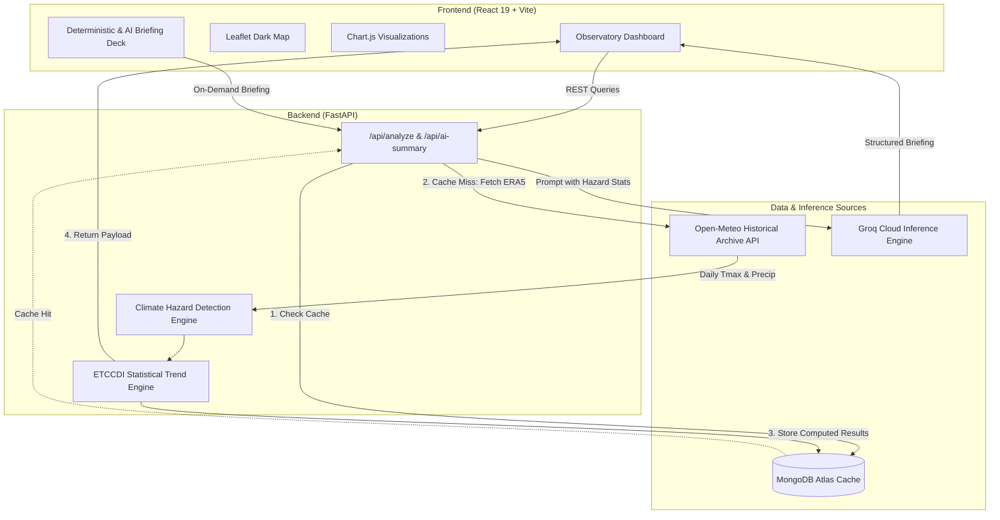

# 🌍 HazardWatch — Meteorological Climate Hazard Trend Analyzer

An observatory-grade climate intelligence platform that ingests multi-decadal historical meteorological data (1950–2025) and visualizes long-term trends in climate hazards—specifically **extreme heatwaves** and **heavy precipitation anomalies**—for any geographic location worldwide.

[](https://fastapi.tiangolo.com)
[](https://react.dev)
[](https://vitejs.dev)
[](https://tailwindcss.com)
[](https://www.chartjs.org)
[](https://www.mongodb.com/atlas)
[](https://opensource.org/licenses/MIT)

---

## 🚀 Key Features

- **Global Geocoding & Geographic Pinning:** Fast, debounced search across any global city or coordinates, coupled with a Leaflet dark observatory map featuring custom glowing climate beacon pins.
- **Dual-Hazard Climatology Engines:**
  - **Heatwaves:** Identifies multi-day extreme heat spells using location-specific 95th-percentile daily maximum temperature baselines ($T_{max} \ge \text{P95}$ for $\ge 3$ consecutive days) in accordance with WMO ETCCDI standards.
  - **Heavy Rainfall:** Identifies prolonged and extreme precipitation anomalies exceeding regional 95th-percentile rainfall baselines or single-day torrential downpours.
- **Multi-Decadal Observation Timeline:** Dual-thumb range slider spanning 1950 to 2025 with instant standard climatology presets (WMO Standard 1990–2020, Recent Warming 2000–2024, Baseline Normal 1980–2010, Full Historical 1950–2024).
- **Interactive Visualization Suite:**
  - **Annual Frequency Chart:** Bar chart of annual event counts juxtaposed with a 5-year rolling average trajectory.
  - **Severity & Duration Chart:** Dual-axis mixed chart comparing consecutive event durations (days) with peak temperature (°C) or maximum daily precipitation (mm).
- **Deterministic Programmatic Insights:** Automated statistical deductions identifying long-term acceleration trajectories, decadal percentage changes, and record outlier years with 1-click clipboard export.
- **Executive AI Climate Briefing:** High-speed executive briefings powered by Groq Cloud (`llama-3.3-70b-versatile`, `openai/gpt-oss-120b`) synthesizing multi-pillar risk tiering, infrastructure/health vulnerabilities, and actionable municipal resilience blueprints.
- **Zero-Key Deterministic Fallback:** Comprehensive offline resilience—if no Groq API key is configured or the network is unreachable, a built-in deterministic climate intelligence engine synthesizes the exact same structured schema without crashing.
- **Distributed Caching Layer:** MongoDB Atlas cache prevents redundant queries to external meteorological APIs for immutable historical time slices.

---

## 🏗️ Architecture & Data Pipeline



---

## 🌡️ Climate Methodology & Definitions

### 1. Heatwave Detection (WMO ETCCDI Standard)
- **Baseline Period:** Computed dynamically across the user-selected observation window for the queried coordinates.
- **Threshold Determination:** The regional 95th percentile ($P95$) of all daily maximum temperatures ($T_{max}$) over the period.
- **Event Criterion:** Consecutive runs of $\ge 3$ consecutive days where daily $T_{max} \ge P95$.
- **Attributes Recorded:** Start date, end date, duration (days), and peak temperature (°C).

### 2. Heavy Rainfall Detection (WMO R95p Standard)
- **Threshold Determination:** The 95th percentile of daily precipitation on wet days ($\ge 1.0\text{ mm}$) over the observation window.
- **Event Criterion:** $\ge 3$ consecutive days of rainfall above the wet-day baseline, or a single-day deluge exceeding $50\text{ mm}$.
- **Attributes Recorded:** Start date, end date, duration (days), cumulative rainfall (mm), and single-day peak intensity (mm/day).

### 3. Trajectory & Rolling Average
- For observation spans $\ge 5$ years, a centered 5-year rolling average is calculated to smooth annual volatility and reveal multi-decadal climate acceleration or deceleration trajectories. For short time horizons ($< 5$ years), the rolling trendline is gracefully omitted with a notification.

---

## 🛠️ Tech Stack

| Layer | Technologies |
|---|---|
| **Frontend Framework** | React 19, Vite, JavaScript (ES Modules) |
| **Styling & Design System** | Tailwind CSS v4, Lucide Icons, Radix Primitives |
| **Mapping** | Leaflet, React-Leaflet, OpenStreetMap Dark Carto Tiles |
| **Charting Engine** | Chart.js 4.4, React-ChartJS-2 |
| **Backend Framework** | Python 3.11, FastAPI, Uvicorn (ASGI) |
| **Data Processing** | NumPy, HTTPX, Pydantic v2 |
| **Database & Caching** | MongoDB Atlas (PyMongo) |
| **AI Inference** | Groq Cloud (`llama-3.3-70b-versatile`, `openai/gpt-oss-120b`) |
| **External Weather API** | Open-Meteo Historical Archive API (ERA5 Reanalysis) |

---

## 📡 API Endpoints

### 1. Health Check
`GET /api/health`
- Returns operational status, MongoDB connectivity, and registered service metadata.

### 2. Hazard Trend Analysis
`GET /api/analyze?lat={lat}&lon={lon}&start_year={start}&end_year={end}&hazard={heatwave|rainfall}`
- Returns complete dual-hazard empirical analysis:
  - `total_events`: Integer count of detected hazards.
  - `threshold`: Regional 95th-percentile cutoff value.
  - `yearly_counts`: Map of `{ [year]: count }`.
  - `rolling_averages`: Map of `{ [year]: 5_year_rolling_mean }`.
  - `events`: Array of individual event metadata (dates, duration, peak severity).
  - `insights`: Programmatic statistical deduction strings.
  - `data_quality`: Completeness score and observation continuity metrics.

### 3. Executive AI Summary
`POST /api/ai-summary`
- Accepts the analyzed dataset payload and synthesizes an executive briefing:
  - `summary`: High-level multi-decadal trajectory synopsis.
  - `risk_level`: Assessed hazard tier (`Critical`, `High`, `Elevated`, `Moderate`).
  - `impacts`: Array of sectoral vulnerabilities (health, power grid, water security).
  - `recommendations`: Actionable municipal resilience blueprints.
  - `is_ai_generated`: Boolean flag indicating LLM inference vs deterministic engine fallback.

---

## ⚙️ Local Development Setup

### Prerequisites
- **Python 3.10+**
- **Node.js 18+** and **npm**
- **MongoDB** connection string (local MongoDB or free MongoDB Atlas cluster)
- *(Optional)* **Groq API Key** (free from [console.groq.com](https://console.groq.com))

---

### 1. Backend Setup

```bash
cd backend

# Create and activate virtual environment
python -m venv venv

# On Windows:
venv\Scripts\activate
# On macOS/Linux:
source venv/bin/activate

# Install dependencies
pip install -r requirements.txt

# Configure environment variables
cp .env.example .env
```

Edit `backend/.env` with your settings:
```env
APP_NAME=HazardWatch API
DEBUG=True
MONGODB_URI=mongodb+srv://<username>:<password>@cluster.mongodb.net/?retryWrites=true&w=majority
MONGODB_DB_NAME=hazardwatch
GROQ_API_KEY=gsk_your_groq_key_here
ALLOWED_ORIGINS=*
```

Start the FastAPI server:
```bash
uvicorn main:app --reload --port 8000
```
- API interactive Swagger docs: `http://localhost:8000/docs`
- Health check: `http://localhost:8000/api/health`

---

### 2. Frontend Setup

```bash
cd frontend

# Install dependencies
npm install

# Configure environment variables
cp .env.example .env
```

Ensure `frontend/.env` points to your backend:
```env
VITE_API_URL=http://localhost:8000
```

Start Vite development server:
```bash
npm run dev
```
- Dashboard runs at: `http://localhost:5173`

---


## 🧪 Quality Assurance & Linting

HazardWatch maintains strict code hygiene standards:

```bash
# Frontend linter (0 errors, 0 warnings enforced)
cd frontend
npm run lint

# Frontend production build validation
npm run build
```

---

## 📄 License
This project is open-source and available under the [MIT License](LICENSE).
